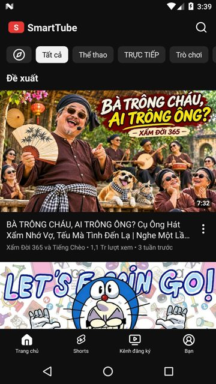
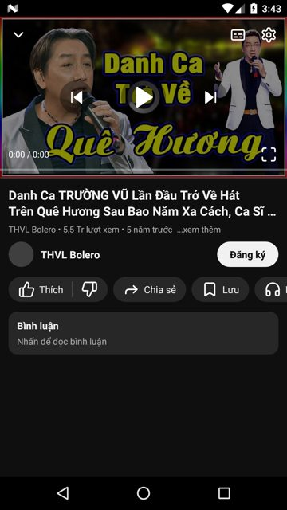
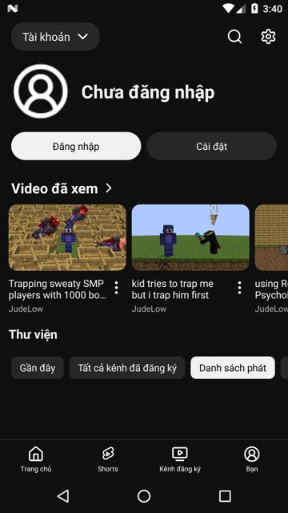
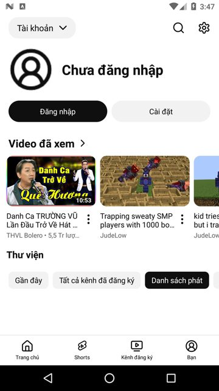
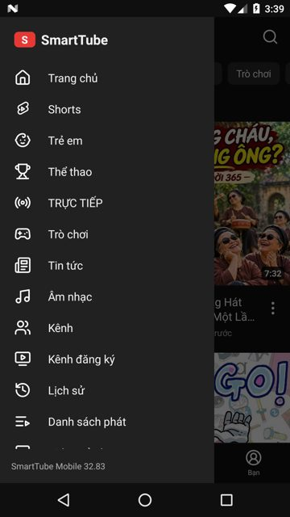
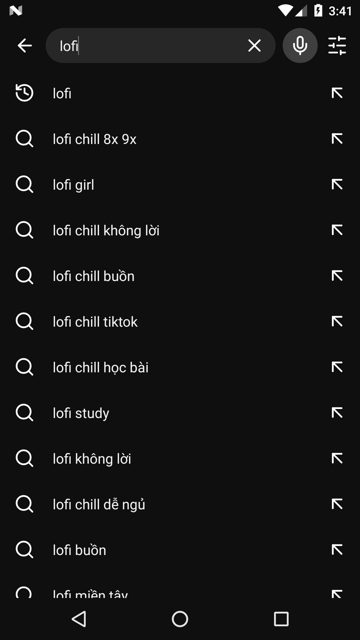
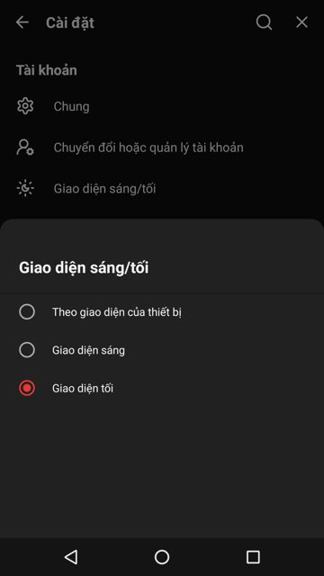
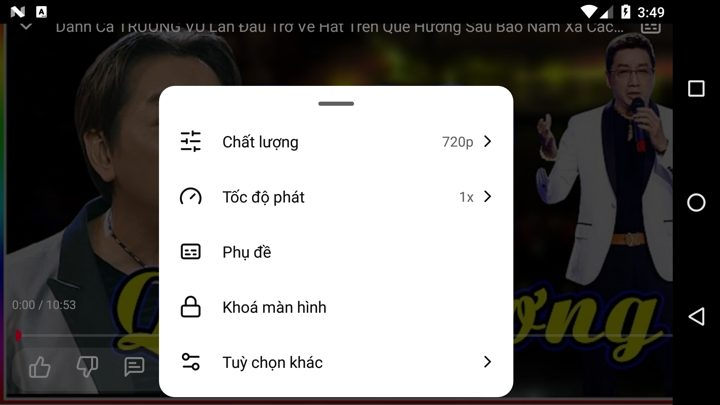

# SmartTube Mobile

**Xem YouTube không quảng cáo trên điện thoại và máy tính bảng Android**, giao diện quen thuộc như app YouTube.

Dựng trên mã nguồn mở của [SmartTube](https://github.com/yuliskov/SmartTube) (tác giả [yuliskov](https://github.com/yuliskov), giấy phép MIT),
vốn chỉ dành cho Android TV. SmartTube Mobile đem các tính năng đó lên điện thoại với giao diện cảm ứng làm lại từ đầu.

**[⬇️ Tải bản mới nhất](https://github.com/ThaiDuyKhang/smarttube-for-mobile/releases/latest)** · Miễn phí · Không quảng cáo · Mã nguồn mở

| Trang chủ | Shorts | Xem video | Bạn |
| --- | --- | --- | --- |
|  |  |  |  |

| Giao diện sáng | Trang Bạn (sáng) | Menu khám phá | Tìm kiếm |
| --- | --- | --- | --- |
|  |  |  |  |

| Cài đặt | Giao diện sáng/tối |
| --- | --- |
|  |  |

| Xem toàn màn hình | Cài đặt nhanh khi xem |
| --- | --- |
|  |  |

## Tính năng

**Xem video**
- Chặn quảng cáo; tự bỏ qua đoạn quảng cáo của người làm video ([SponsorBlock](https://sponsor.ajay.app)); tiêu đề và ảnh đúng nội dung ([DeArrow](https://dearrow.ajay.app))
- Chất lượng cao đến 4K, 60fps, HDR (tuỳ máy); chỉnh tốc độ phát, phụ đề, ngôn ngữ âm thanh
- **Phát nền**: tắt màn hình hoặc mở app khác vẫn nghe tiếp, có nút điều khiển trên màn hình khóa
- **Hình trong hình (PiP)**: bấm Quay lại hoặc Home khi đang xem, video thu nhỏ ở góc màn hình
- Toàn màn hình khi xoay ngang, chạm đúp để tua 10 giây, khoá màn hình khi xem
- Shorts toàn màn hình, vuốt lên để xem video tiếp theo

**Giao diện giống app YouTube**
- 4 tab: Trang chủ, Shorts, Kênh đăng ký, Bạn (hiện ảnh đại diện khi đã đăng nhập)
- Hàng chip lọc (Tất cả, Âm nhạc, Thể thao, Trực tiếp… và **Đề xuất mới**), thanh trên cùng tự ẩn khi cuộn
- Trang kênh, trang tất cả kênh đã đăng ký, trang Bạn với lịch sử xem và thư viện
- **Giao diện sáng, tối** hoặc theo điện thoại
- Nhấn giữ rồi kéo để sắp xếp lại menu, chip lọc và mục cài đặt theo ý bạn

**Tài khoản**
- Đăng nhập tài khoản YouTube để thích, lưu vào danh sách phát, đăng ký kênh, xem lịch sử
- Nhiều tài khoản, chuyển qua lại nhanh

**Cập nhật ngay trong app**: Cài đặt → Cài đặt khác → Kiểm tra cập nhật.

## Tải về và cài đặt

### 1. Chọn đúng file

Vào trang **[Releases](https://github.com/ThaiDuyKhang/smarttube-for-mobile/releases/latest)**, kéo xuống mục **Assets** và tải **một** file:

| File | Dùng cho |
| --- | --- |
| `SmartTube_mobile_..._arm64-v8a.apk` | **Hầu hết điện thoại, máy tính bảng từ năm 2017 trở lại đây. Nên chọn file này.** |
| `SmartTube_mobile_..._armeabi-v7a.apk` | Máy đời cũ (chip 32-bit) |
| `SmartTube_mobile_..._universal.apk` | Không biết máy mình loại nào: file này chạy trên mọi máy (dung lượng lớn hơn) |
| `..._x86.apk`, `..._x86_64.apk` | Chromebook, máy tính bảng chip Intel, trình giả lập |

Không chắc máy loại nào thì tải bản **universal**. Cài nhầm bản không hợp máy thì Android chỉ báo
"Ứng dụng chưa được cài đặt", không ảnh hưởng gì đến máy.

**Yêu cầu:** Android 5.0 trở lên. **Không có bản cho iPhone/iPad** (iOS không cài được file APK).

### 2. Cài đặt

1. Mở file APK vừa tải (trong thông báo tải xuống hoặc ứng dụng **Tệp / File**).
2. Nếu Android hỏi **"Cho phép cài ứng dụng từ nguồn này?"**: bật cho phép rồi quay lại.
3. Nếu **Google Play Protect** cảnh báo ứng dụng không rõ nguồn: bấm **Thêm chi tiết** → **Vẫn cài đặt**.
   Cảnh báo này xuất hiện với mọi app không tải từ CH Play; mã nguồn của app công khai ở repo này.
4. Bấm **Cài đặt**, rồi **Mở**.

### 3. Đăng nhập (không bắt buộc)

1. Vào tab **Bạn** → **Đăng nhập**.
2. Bấm **Đăng nhập từ trình duyệt** (mã đã được sao chép sẵn), dán mã vào trang Google vừa mở và chọn tài khoản.
   Hoặc dùng máy khác quét mã QR, hay mở https://yt.be/activate và nhập mã.
3. Quay lại app, bấm **Đã xong**.

App dùng cách đăng nhập bằng mã thiết bị của Google: bạn nhập mật khẩu trên trang của Google, app không nhìn thấy mật khẩu.

### 4. Cập nhật lên bản mới

- Trong app: **Bạn → ⚙️ Cài đặt → Cài đặt khác → Kiểm tra cập nhật → Tải và cài đặt**.
  Lần đầu, Android hỏi cho phép SmartTube cài ứng dụng: bật cho phép rồi quay lại.
- Hoặc tải APK mới ở trang Releases và cài đè lên bản đang có.

Cập nhật **giữ nguyên** tài khoản, cài đặt và lịch sử. **Không gỡ app trước khi cập nhật**: gỡ app sẽ mất đăng nhập và cài đặt.

> Chỉ tải SmartTube Mobile từ trang Releases của repo này. Không cài bản đăng lại trên các trang APK khác.

## Câu hỏi thường gặp

**Video không phát hoặc báo lỗi?**
YouTube thay đổi thường xuyên: vào **Kiểm tra cập nhật** để lấy bản mới nhất. Vẫn lỗi thì thử
Cài đặt → Trình phát video → đổi **Trình xử lý mạng**.

**Tắt màn hình thì mất tiếng?**
Trên trang xem video, bật nút **Phát nền**. Trên Android 13 trở lên, cho phép app gửi thông báo để có nút điều khiển
trên màn hình khóa. Một số máy (Xiaomi, Oppo, Samsung…) cần tắt **Tối ưu pin** cho SmartTube trong cài đặt điện thoại.

**Không thấy cửa sổ nhỏ (PiP)?**
Cài đặt điện thoại → Ứng dụng → SmartTube Mobile → **Hình trong hình** → Cho phép.

**Cài song song với SmartTube bản TV được không?**
Được. SmartTube Mobile có mã ứng dụng riêng (`app.smarttube.mobile`).

**App có gửi dữ liệu của tôi đi đâu không?**
App không chạy quảng cáo hay công cụ theo dõi. App chỉ kết nối tới YouTube, tới SponsorBlock/DeArrow nếu bạn bật
hai tính năng này, và tới GitHub khi kiểm tra cập nhật.

## Ủng hộ tác giả

SmartTube Mobile hoàn toàn miễn phí. Nếu thấy hữu ích, bạn có thể ủng hộ tác giả một ly cà phê:
trong app vào **Cài đặt → Trợ giúp và phiên bản → Ủng hộ tác giả** (mã QR ngân hàng MB Bank).

Báo lỗi hoặc góp ý: mở một [Issue](https://github.com/ThaiDuyKhang/smarttube-for-mobile/issues) kèm ảnh chụp màn hình.

## Dành cho nhà phát triển

Yêu cầu: JDK 17, Android SDK (platform 34).

```bash
git clone https://github.com/ThaiDuyKhang/smarttube-for-mobile.git
cd smarttube-for-mobile
./gradlew :smarttubetv:assembleStmobileDebug
```

APK nằm ở `smarttubetv/build/outputs/apk/stmobile/`.

- Giao diện điện thoại: `smarttubetv/src/main/java/.../tv/ui/mobile/` (trang chủ, xem video, tìm kiếm, kênh, cập nhật…),
  layout `mobile_*.xml`, chuỗi chữ `common/src/main/res/values*/mobile_strings.xml`.
- Flavor `stmobile` (manifest ở `smarttubetv/src/stmobile/`). Các bản TV (`stbeta`, `ststable`…) không thay đổi.
- **Phát hành:** đẩy tag dạng `v32.83-mobile.<số>` (số sau lớn hơn số trước). GitHub Actions (`.github/workflows/mobile.yml`)
  build, ký và đăng APK lên Releases. Cần các secret `SIGNING_KEY` (file `.jks` dạng base64), `KEY_STORE_PASSWORD`,
  `ALIAS`, `KEY_PASSWORD`. Tính năng cập nhật trong app đọc số cuối của tag để so sánh phiên bản.

## Bản quyền

- Mã nguồn gốc: © 2020-present [yuliskov](https://github.com/yuliskov) và các cộng tác viên SmartTube, giấy phép [MIT](LICENSE).
- Icon: [Lucide](https://lucide.dev) (giấy phép ISC, xem [docs/licenses](docs/licenses)).
- README gốc của SmartTube: [docs/README-upstream.md](docs/README-upstream.md).
- Dự án không liên kết với YouTube hay Google. YouTube là nhãn hiệu của Google LLC.
