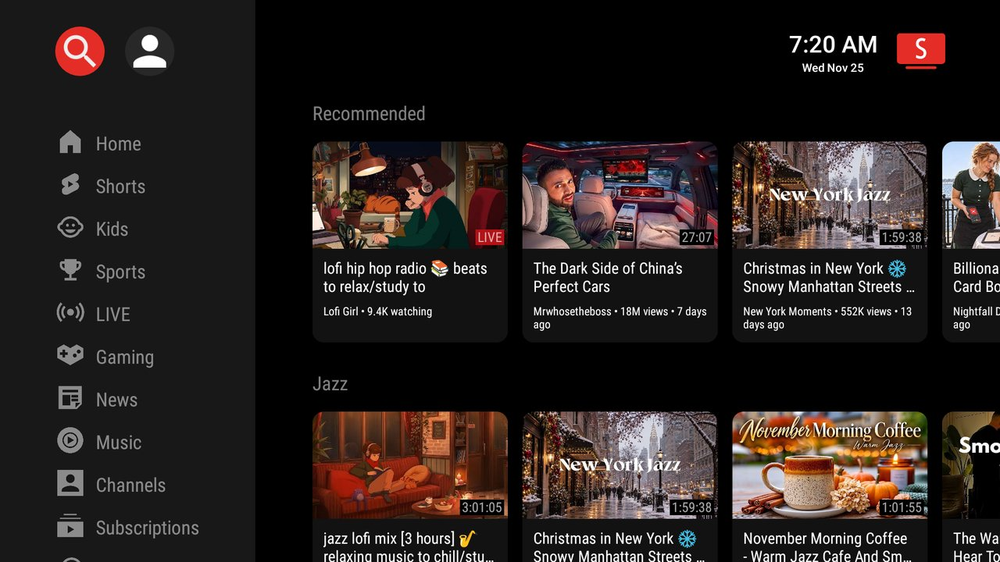
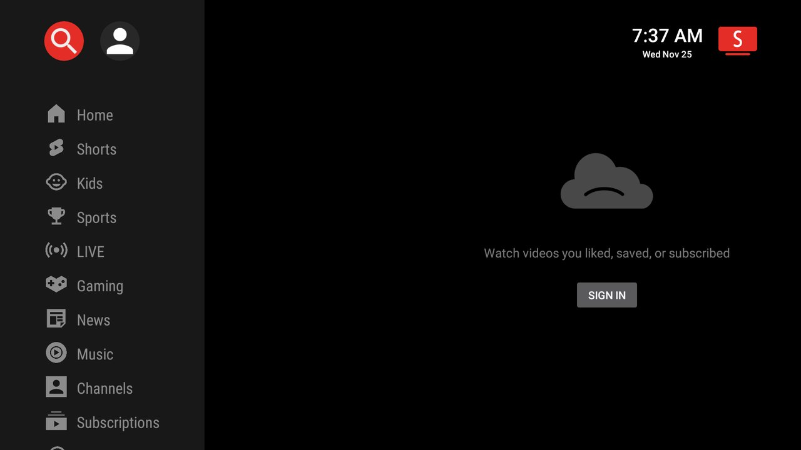
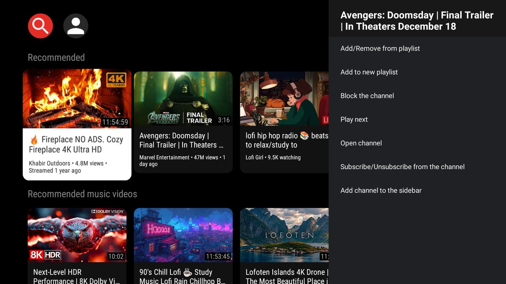
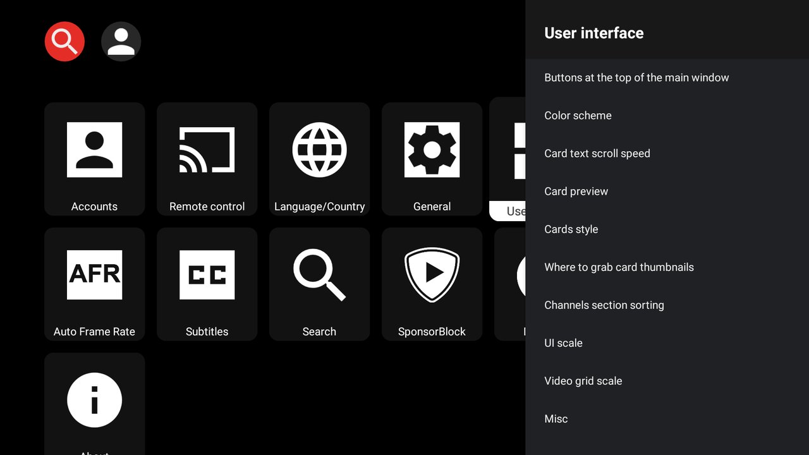
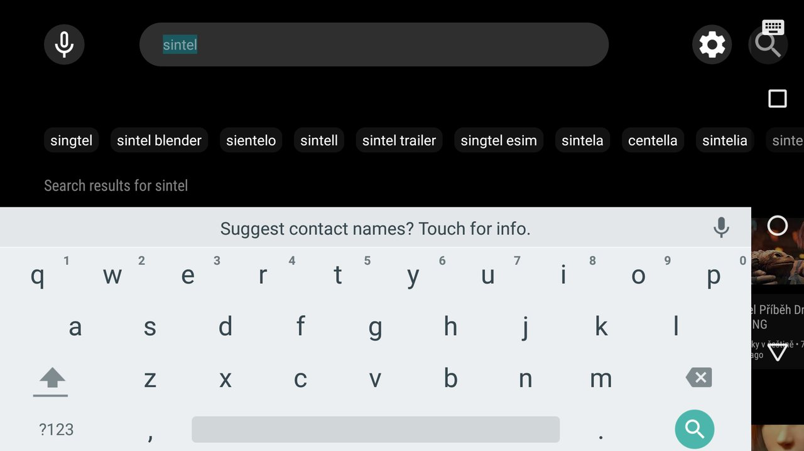

# SmartTube Mobile

Bản **SmartTube cho điện thoại và máy tính bảng Android**, dựng trên mã nguồn gốc của
[SmartTube](https://github.com/yuliskov/SmartTube) (tác giả [yuliskov](https://github.com/yuliskov), giấy phép MIT).

Ứng dụng giữ **nguyên vẹn giao diện và toàn bộ tính năng** của SmartTube trên TV: chặn quảng cáo, SponsorBlock, DeArrow,
chỉnh tốc độ phát, 8K/HDR/60fps, live chat, đăng nhập tài khoản, nhiều tài khoản, điều khiển từ xa... Phần được bổ sung
chỉ nhằm để app dùng tốt bằng **màn hình cảm ứng** trên điện thoại và tablet.



| Trình phát | Menu khi chạm giữ | Cài đặt | Tìm kiếm |
| --- | --- | --- | --- |
|  |  |  |  |

## Khác gì so với bản TV

| | Bản TV (gốc) | SmartTube Mobile |
| --- | --- | --- |
| Thiết bị | Android TV, TV box, Fire TV | Điện thoại, máy tính bảng Android 5.0 trở lên |
| Hướng màn hình | Theo TV | Luôn nằm ngang, xoay được cả hai chiều theo cảm biến |
| Chạm vào video, nút, mục cài đặt | Chạm lần 1 chỉ chọn, lần 2 mới mở | **Chạm 1 lần là mở** |
| Thanh hệ thống sau khi gõ phím | Có thể nằm đè lên nội dung | Tự ẩn lại khi bàn phím đóng |
| Sửa từ khóa khi đang xem kết quả tìm kiếm | Cần phím Lên của điều khiển | Chạm vào vùng trống phía trên kết quả |
| Mã ứng dụng | `org.smarttube.beta` / `org.smarttube.stable` | `app.smarttube.mobile` (cài song song được với bản TV) |
| Tự cập nhật trong app | Có (tải bản TV) | Tắt, tải bản mới ở mục Releases |

Mọi thay đổi chỉ có hiệu lực ở bản mobile (flavor `stmobile`). Các bản TV `stbeta`, `ststable`, `stfdroid` vẫn build và
hoạt động như bản gốc.

## Cài đặt

1. Vào mục **Releases** của repo này và tải file APK phù hợp:
   - `SmartTube_mobile_..._arm64-v8a.apk`: hầu hết điện thoại và tablet từ năm 2017 trở lại đây (**nên chọn**)
   - `SmartTube_mobile_..._armeabi-v7a.apk`: máy đời cũ (32-bit)
   - `SmartTube_mobile_..._universal.apk`: nếu không chắc máy mình thuộc loại nào (file lớn hơn)
   - `x86`, `x86_64`: Chromebook, trình giả lập
2. Mở file APK và cho phép "Cài đặt ứng dụng không rõ nguồn gốc" khi được hỏi.
3. Bản mới: tải APK mới và cài đè lên. Cài đè chỉ được khi các bản đều ký bằng cùng một khóa (xem phần "Ký APK").

> Chỉ tải APK từ repo này. Không cài bản đăng lại trên các trang APK khác.

## Thao tác cảm ứng

| Thao tác | Kết quả |
| --- | --- |
| Chạm vào video, kênh, nút, mục cài đặt | Mở ngay |
| Chạm giữ video | Menu: thêm vào playlist, mở kênh, chặn kênh, phát tiếp theo... |
| Chạm mục ở menu bên trái | Lần 1: xem trước mục đó. Lần 2: vào nội dung (thiết kế gốc của SmartTube) |
| Nút Back hoặc vuốt từ mép trái | Quay lại hoặc mở menu bên trái |
| Chạm vào video đang phát | Hiện hoặc ẩn bảng điều khiển |
| Chạm đúp nửa trái hoặc nửa phải video | Tua lùi hoặc tua tới |
| Kéo thanh thời gian | Tua đến vị trí mong muốn |
| Khi đang xem kết quả tìm kiếm, chạm vùng trống phía trên | Hiện lại ô tìm kiếm để sửa từ khóa |

**Đăng nhập:** Settings → Accounts → Sign in. Mã hiện trên màn hình, bấm **Login from browser** để mở trang đăng nhập ngay
trên điện thoại, hoặc nhập mã ở https://yt.be/activate trên thiết bị khác.

## Build từ mã nguồn

Yêu cầu: JDK 17, Android SDK (platform 34, build-tools 30.0.3).

```bash
git clone --recurse-submodules https://github.com/ThaiDuyKhang/smarttube-for-mobile.git
cd smarttube-for-mobile
./gradlew :smarttubetv:assembleStmobileDebug
```

APK nằm ở `smarttubetv/build/outputs/apk/stmobile/`.

### Ký APK (bản release)

Tạo file `keystore.properties` ở thư mục gốc. File này đã có trong `.gitignore`, **không commit**.

```properties
storePassword=...
keyAlias=...
keyPassword=...
storeFile=/đường/dẫn/tới/khoa.jks
```

Sau đó chạy `./gradlew :smarttubetv:assembleStmobileRelease`.

### Build tự động bằng GitHub Actions

Workflow `.github/workflows/mobile.yml` chạy lint và build APK mỗi khi có push lên `main`.
Để có bản release đã ký và tự đăng lên mục Releases khi đẩy tag (ví dụ `v32.83-mobile.1`), thêm các secret sau
trong *Settings → Secrets and variables → Actions*:

| Secret | Giá trị |
| --- | --- |
| `SIGNING_KEY` | Nội dung file `.jks` mã hóa base64 (`base64 -w0 khoa.jks`) |
| `KEY_STORE_PASSWORD` | Mật khẩu keystore |
| `ALIAS` | Alias của khóa |
| `KEY_PASSWORD` | Mật khẩu khóa |

Nếu chưa có secret, workflow sẽ build bản debug và đính kèm APK vào lần chạy workflow (mục Artifacts).

## Giới hạn

- Chỉ chạy trên **Android**. iPhone và iPad không cài được APK.
- Giao diện là giao diện TV, nên luôn hiển thị ở chế độ ngang.
- Các mục chỉ dành cho TV (Auto Frame Rate, kênh trên màn hình chính Android TV) vẫn còn trong cài đặt nhưng không có
  tác dụng trên điện thoại.

## Cấu trúc thay đổi (cho người đóng góp)

- `smarttubetv/build.gradle`, `common/build.gradle`, `leanbackassistant/build.gradle`: flavor `stmobile`
- `smarttubetv/src/stmobile/`: manifest (không bắt buộc leanback, touchscreen, usb, bluetooth), tên app, icon
- `common/.../misc/SingleTapClickHelper.java`: chạm 1 lần để mở
- `common/.../misc/SystemBarsHelper.java`, `MotherActivity.java`: khóa hướng ngang, giữ chế độ toàn màn hình
- `smarttubetv/.../search/SearchSupportFragment.java`: chạm để hiện lại ô tìm kiếm
- `common/.../utils/Utils.java`: `isMobileBuild()`, kích thước màn hình thật khi ẩn thanh hệ thống

## Bản quyền

- Mã nguồn gốc: © 2020-present [yuliskov](https://github.com/yuliskov) và các cộng tác viên SmartTube, giấy phép [MIT](LICENSE).
- README gốc của SmartTube: [docs/README-upstream.md](docs/README-upstream.md).
- Dự án không liên kết với YouTube hay Google.
